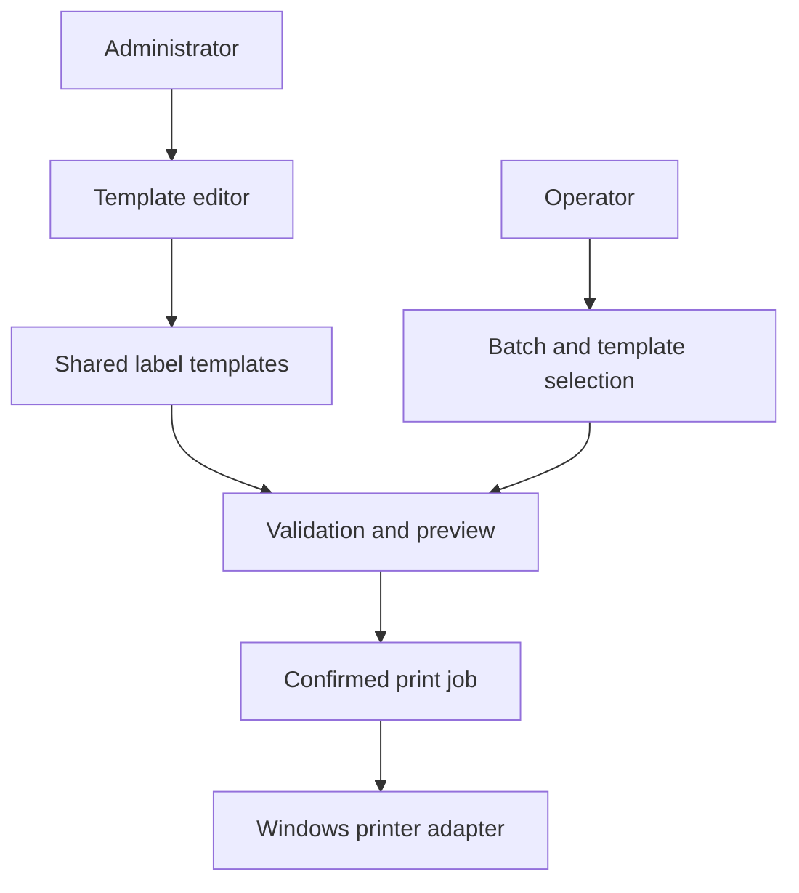

# Printer App — Label Design and Production Printing — Architecture

Administrators prepare reusable label templates; operators load those templates with batch data, inspect the output and confirm printing. The project separates template authoring from production use while keeping the interpretation of label geometry consistent.

## Components

| Component | Responsibility |
|---|---|
| Administration application | C#/.NET with Avalonia and MVVM for template editing and verification. |
| Operator application | Python/Tkinter interface for batch loading, preview and printing. |
| Domain and application layers | Label concepts, editing operations, verification and use cases. |
| Rendering and printing adapters | Preview generation, barcode handling and Windows printer access. |
| Shared documents | External template definitions and batch inputs exchanged by the two applications. |

## Main interactions

## Responsibility boundaries

- Separate authoring from production printing. Operators can use prepared templates without editing their design.
- Preview and print output follow consistent geometry. The preview can expose layout and data problems before a print job.
- Keep printer access behind adapters. Domain and UI behavior can be tested without issuing a physical print.

## Constraints

Barcode previews and software tests do not replace checks on the actual printer, media and production workstation.

## Technology

C#/.NET, Avalonia, MVVM, Python, Tkinter, XML and ZPL.
